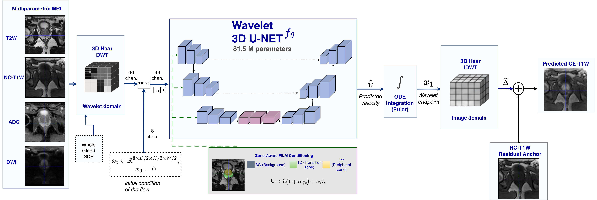

# ResWFM: Zone-Aware Residual Wavelet Flow Matching for Contrast-Enhanced Prostate MRI Synthesis

Reference implementation for a submission to IEEE Transactions on Medical Imaging.
ResWFM synthesizes a late-phase contrast-enhanced T1-weighted (CE-T1W) prostate
MRI volume from non-contrast multiparametric MRI by predicting the enhancement
**residual** in the wavelet domain:

```
CE-T1W = NC-T1W + Δ̂,   Δ̂ = IDWT( f_θ( DWT(0), c, t ) )
```

> **Note (anonymous review):** author names and institutional references are
> withheld below pending the outcome of double-blind review. `LICENSE` uses
> a placeholder copyright holder for the same reason. Replace both once the
> manuscript's authorship is no longer under review — see the `TODO` markers
> in `LICENSE`.

## Paper

> Building on our Wavelet Flow Matching (WFM) framework, we introduce ResWFM
> for synthesis of a late-phase contrast-enhanced T1-weighted (CE-T1W) volume
> from multimodal non-contrast prostate MRI. ResWFM predicts the enhancement
> residual in an invertible 3D Haar wavelet domain, using pre-contrast T1W
> (NC-T1W) as an anatomical anchor, with zone conditioning and a
> frequency-graded, zone-weighted objective. On the held-out test set, ResWFM
> achieved competitive whole-volume synthesis performance (21.42 dB PSNR and
> 0.789 SSIM) and improved prostate-region fidelity (0.761 whole-gland SSIM
> and 0.729 peripheral-zone SSIM), with a two-step inference time of 0.12 s
> per subject.

— manuscript abstract, quoted verbatim.

## Architecture

<p align="center">
  
</p>

Non-contrast sequences (T2W, NC-T1W, ADC, DWI) and a whole-gland signed
distance function (SDF) are transformed into the 3D Haar wavelet domain and
concatenated with the flow state `x_t`, giving a 48-channel input to a 3D
U-Net velocity network `f_θ` (~81.5M parameters). Starting from a **zero**
source (`x_0 = 0`, not noise and not an averaged prior), the network's
predicted velocity is integrated with a small number of Euler steps to reach
the wavelet-domain endpoint `x̂_1`. An inverse DWT recovers the image-space
residual Δ̂, which is added to the NC-T1W anchor to produce the synthesized
volume. One-hot **Zone-FiLM** conditioning (BG / TZ / PZ) modulates encoder
features at each of the four downsampling stages.

**Why this design:**
- **Residual, not direct, target.** The enhancement signal Δ is near zero
  almost everywhere outside the gland. Predicting Δ instead of the full
  CE-T1W image lets anatomy come "for free" from NC-T1W, so model capacity
  concentrates on the actual contrast-enhancement signal rather than
  re-deriving anatomy the network already has access to as input.
- **Wavelet domain.** The Haar DWT both reduces spatial resolution (making
  3D volumetric processing tractable) and places a sparse, localized signal
  like Δ into a small number of informative subbands.
  (`guided_diffusion/wfm_prostate_run07.py`)
- **Zone-FiLM.** Prostate cancer detection and enhancement characteristics
  differ by anatomical zone (background / transition zone / peripheral
  zone). Zone-FiLM gives the network a learned per-zone feature modulation
  at every encoder stage, rather than one global mapping applied uniformly
  across the volume. (`guided_diffusion/zone_film.py`)
- **Frequency-graded, zone-weighted objective.** The training loss combines
  wavelet-domain subband weighting (graded by how many high-pass axes a
  subband has) with zone-weighted and image-space terms, so the gradient
  signal concentrates on the gland, its boundary, and fine enhancement
  detail rather than being dominated by background voxels.
  (`scripts/train_wfm_prostate_mask.py`)

These are the method's design motivations, not independent per-component
performance claims — see [Quantitative results](#quantitative-results) for
what the experiments actually show, and the manuscript's ablation section
for which components were isolated.

**Terminology note:** ResWFM synthesizes a single **late-phase CE-T1W
volume** — the last acquired DCE frame — not the full temporal DCE kinetic
series, and it is not a substitute for a complete clinical DCE examination.

## Motivation

CE-T1W imaging provides vascular information that is central to detecting
and characterizing prostate cancer, alongside non-contrast sequences (T2W,
NC-T1W, DWI, ADC). Acquiring it requires a gadolinium-based contrast agent,
which adds time and cost and carries risk in patients with renal impairment
or concerns about repeated gadolinium exposure. This motivates synthesizing
CE-T1W from routinely acquired non-contrast sequences.

The task is difficult because contrast enhancement depends on contrast-agent
kinetics and tissue-specific vascular properties that are not directly
observable in non-contrast images — the model must infer enhancement from
indirect anatomical and functional cues. Prior CE-T1W synthesis approaches
typically predict the target image directly, requiring the network to
simultaneously reconstruct anatomy and the much subtler, spatially localized
enhancement signal. ResWFM instead anchors generation to NC-T1W and
predicts only the residual, under the hypothesis that separating "anatomy
(given)" from "enhancement (learned)" lets the model concentrate capacity on
the harder, clinically relevant part of the problem.

## Relationship to WFM

ResWFM's method-level contributions — the non-contrast-anchored residual
reframing, Zone-FiLM, the frequency-graded subband loss, and the
zone-weighted training/evaluation pipeline — are original to this work and
do not exist in the public WFM codebase
(https://github.com/yalcintur/WFM), which targets unconditional BraTS
multi-modality synthesis via a mean-of-modalities prior, not a residual
formulation. What *is* shared is generic infrastructure (the 3D UNet
backbone, Haar DWT/IDWT wiring, logging/dist utilities, base training-loop
skeleton) — vendored into `guided_diffusion/`/`DWT_IDWT/` here under their
original MIT license (see [License](#license-and-third-party-notices)).
**This repo has no runtime dependency on the WFM repository** — everything
needed to train, sample, and evaluate ResWFM is self-contained here.

## Qualitative results

<p align="center">
  
</p>

Three representative lesion-containing test cases (rows), each showing, left
to right: **T2W** (lesion contour in green, arrow marking the lesion),
**NC-T1W**, the **reference (ground-truth) CE-T1W**, then CE-T1W images
synthesized by **ResWFM**, **WFM**, **AAD-DCE**, **DCE-Diff**, and
**Pix2Pix**. When comparing panels, look at whether gland-wide contrast
enhancement is recovered and whether the signal pattern near the marked
lesion resembles the reference column — these panels are illustrative
examples, not a substitute for the quantitative evaluation below.

## Quantitative results

### Inference efficiency

All models evaluated on the same 160×160×32 benchmark; parameter
counts reflect each model's actual training configuration, and inference
time is the mean over test subjects.

| Model | Inference configuration | Parameters (M) | Avg. time (s/subject) |
|---|---|---:|---:|
| Pix2Pix | 2D, single-pass | 61.40 | 0.72 |
| AAD-DCE | 2D, single-pass | 11.38 | 0.35 |
| DCE-Diff | 100-step DDPM | 73.93 | 85.2 |
| T1C-RFlow | 50-step RFlow | 44.26† | 1.39 |
| WFM | 2-step Euler | 81.52 | 0.11 |
| **ResWFM (proposed)** | **2-step Euler** | **81.54** | **0.12** |

† T1C-RFlow additionally uses a frozen, pretrained MAISI variational
autoencoder (20.94M parameters) for latent encoding/decoding, not included
in the trainable parameter count shown.

WFM and ResWFM have nearly identical parameter counts and inference times —
the manuscript reports no clear evidence of a meaningful speed difference
between the two. Both are substantially faster than the GAN, diffusion, and
latent-flow baselines evaluated, which reflects the efficiency of two-step
wavelet flow matching generally, not an advantage specific to residual
prediction. These numbers were measured once, on one hardware configuration,
for the manuscript's benchmark; they are not a hardware-independent
comparison, and differences in implementation, dimensionality (2D vs. 3D),
and sampling procedure mean this table does not represent total
computational cost on an equal footing across methods.

### Reconstruction and enhancement fidelity

On the held-out test set (n=57 subjects; lesion-level metrics on 34
subjects with annotated index lesions):

- **Whole-volume:** WFM achieved the highest whole-volume PSNR/SSIM among
  all evaluated methods (22.67 dB / 0.812). ResWFM's whole-volume
  performance was competitive but lower (21.42 dB / 0.789) — **WFM, not
  ResWFM, is best on this metric.**
- **Zonal (whole-gland / transition-zone / peripheral-zone) SSIM:** ResWFM
  achieved the highest SSIM among all evaluated methods in every zone
  (0.761 / 0.751 / 0.729), while WFM retained the highest whole-volume
  numbers. The manuscript treats this as a genuine trade-off between
  whole-volume and zonal fidelity, not a uniform win for either model.
- **Whole-gland enhancement MAE:** ResWFM achieved the lowest whole-gland
  MAE among all evaluated methods (0.0895 vs. 0.0985 for WFM), a
  statistically significant improvement over every synthesis comparator
  after Holm correction (Holm-adjusted p ≤ 0.001).
- **Lesion-level metrics:** the reported lesion-level comparisons
  (lesion MAE, lesion-to-gland contrast error) **do not establish
  lesion-level superiority for ResWFM.** WFM had numerically lower lesion
  MAE (0.0949 vs. 0.1007) and lower contrast error, but neither difference
  was statistically significant after correction. Lesion-level findings are
  further limited by annotation coverage (34 cases with index-lesion
  annotations, not comprehensive per-lesion annotation).

These results are reported as a balanced summary, not as evidence that
ResWFM improves every metric — see the manuscript's Results and Discussion
sections for the complete statistical comparison, ablations, and stated
limitations (including single-institution training data and the absence of
cross-modality registration beyond DICOM-coordinate resampling).

## Installation

```bash
git clone <this-repository-url>
cd ResWFM-release
pip install -r requirements.txt
```

Requires Python 3.10+, PyTorch 2.0+. A GPU is strongly recommended for
training; inference (1–2 integration steps) is fast enough to run on CPU for
a single case.

## Model configuration

This repository packages exactly one configuration: **ResWFM (Run10,
zone-FiLM) at 160×160×32**, the 5-level UNet backbone
(`channel_mult=1,2,2,4,4`) configured in `run_reswfm.sh`'s `COMMON_ARGS` — the
configuration used for the manuscript's reported results. No other
architecture depth, backbone, or component-ablation variant is included
here.

Instantiating this exact configuration measures **81,543,304 parameters**
(verified by building the model directly from `train_wfm_prostate_run10.py`
with `run_reswfm.sh`'s arguments), matching the manuscript's reported
81.543M to the parameter. Of these, 4,608 parameters are the four Zone-FiLM
modulation layers — the rest is the shared UNet backbone.

## Inference / usage

No trained checkpoint or example data ships in this repository (see
[Data and pretrained weights](#data-and-pretrained-weights)), so you need
your own checkpoint and your own correctly-formatted inputs to run this.
The inference pipeline itself has been exercised end-to-end against a
trained checkpoint and a real test case external to this repository,
producing geometrically and numerically valid output consistent with
expected reconstruction quality — see
[`inference/README.md`](inference/README.md) for the full workflow. This
confirms the pipeline is correct; it does not establish accuracy across a
full cohort, and no checkpoint or test data is included here for you to
reproduce that result directly.

1. **Obtain or train a checkpoint** — see
   [Data and pretrained weights](#data-and-pretrained-weights).
2. **Prepare one subject's inputs** as
   `T2.nii.gz`, `ADC.nii.gz`, `DWI.nii.gz`, `NC_T1.nii.gz`, `CE_T1.nii.gz`,
   `mask.nii.gz` — see [Data format](#data-format-expected-input-contract)
   below. `CE_T1.nii.gz` is required for the data loader to accept the
   subject at all (a file-completeness check), even though it is never
   passed to the model as a conditioning input — only `T2`, `ADC`, `DWI`,
   and `NC_T1` are. Preprocessing to this exact format is not included in
   this repository (see
   [Data and pretrained weights](#data-and-pretrained-weights)).
3. **Run inference** — see [`inference/README.md`](inference/README.md) for
   the full worked example and exact command, or:
   ```bash
   bash run_reswfm.sh sample_test   # if using the full test-manifest workflow
   ```
4. **Evaluate**, if ground-truth `CE_T1.nii.gz` is available — see
   [Evaluation](#evaluation) below.

For the full training/resume/sample/eval command set:

```bash
export RESWFM_DATA_DIR=/path/to/your/dataset
export RESWFM_SPLIT_DIR=/path/to/your/split/manifests

bash run_reswfm.sh sanitycheck   # 10 iterations, smoke test
bash run_reswfm.sh train         # full training run
bash run_reswfm.sh resume        # resume from the latest checkpoint
bash run_reswfm.sh sample_test   # inference on the test manifest
bash run_reswfm.sh eval_test     # PSNR/SSIM/MSE/MAE within the prostate mask
```

## Evaluation

`scripts/evaluate_prostate_run10.py` computes PSNR, SSIM, MSE, and MAE
between `sample_wfm_prostate_run10.py`'s predicted and target NIfTI outputs.
With `--use_mask`, metrics are restricted to the non-zero (prostate) region,
matching the manuscript's whole-gland evaluation:

```bash
python scripts/evaluate_prostate_run10.py \
    --pred_dir <output_dir from sample_wfm_prostate_run10.py> \
    --output   metrics_ce_t1_run10.txt \
    --use_mask --verbose
```

This script is not zone-stratified (it does not separately report TZ/PZ
metrics) — it reproduces the whole-gland-masked PSNR/SSIM/MSE/MAE numbers,
not the full per-zone breakdown reported in the manuscript's tables.

## Data format (expected input contract)

```
<subject_dir>/T2.nii.gz
<subject_dir>/ADC.nii.gz
<subject_dir>/DWI.nii.gz
<subject_dir>/NC_T1.nii.gz
<subject_dir>/CE_T1.nii.gz      # required by the data loader at inference too (see note above); never fed to the model
<subject_dir>/mask.nii.gz       # 0=background, 1=TZ, 2=PZ
```

NC_T1 and CE_T1 must be normalized with **NC_T1's own** foreground intensity
window applied to both (never a window derived from CE_T1, which is
unavailable at inference time) — this is required by the residual
formulation, not a preprocessing convenience.

## Data and pretrained weights

- **Data.** No imaging data is distributed here. The training cohort is a
  single-institution dataset and is not yet publicly released.
- **Preprocessing.** The resampling/cropping/normalization pipeline that
  turns raw DICOM/NIfTI into the model's expected input format is not
  included in this repository. [`inference/README.md`](inference/README.md)
  documents the *expected output* format of that pipeline so the model's
  input contract is fully specified even without the pipeline itself.
- **Split manifests.** Train/val/test subject-ID lists are withheld along
  with the data they index.
- **Trained checkpoints.** Not released yet. Once available, a checkpoint
  trained on the 160×160×32 configuration will be published separately
  (e.g., Zenodo or Hugging Face Hub) and linked from this README, along
  with the exact training command used.

Because of the above, **inference does not work immediately after cloning**
this repository — you need your own checkpoint (trained with
`run_reswfm.sh train` on your own correctly-formatted data) and your own
correctly-formatted input volumes.

## Repository structure

```
ResWFM-release/
├── docs/figures/              Architecture + qualitative-results figures
├── guided_diffusion/          Model, losses, Zone-FiLM, data loader
├── DWT_IDWT/                  3D Haar DWT/IDWT (CC BY-NC-SA 4.0, see below)
├── scripts/                   Train / sample (inference) / evaluate entry points
├── inference/                 Worked single-case inference example
├── run_reswfm.sh              Genericized train/sample/eval driver script
├── requirements.txt
└── LICENSE, THIRD_PARTY_NOTICES.md, DWT_IDWT/LICENSE
```

## License and third-party notices

This repository is **dual-licensed**:

- Everything except `DWT_IDWT/` is **MIT** (see `LICENSE`).
- `DWT_IDWT/` (the Haar DWT/IDWT implementation) is **CC BY-NC-SA 4.0**
  (Adobe Inc.), **non-commercial only** — see `DWT_IDWT/LICENSE`.

See `THIRD_PARTY_NOTICES.md` for the full explanation and attribution
chain.

## Citation

```bibtex
@article{anonymous2026reswfm,
    title   = {Zone-Aware Residual Wavelet Flow Matching for Contrast-Enhanced Prostate MRI Synthesis},
    author  = {Anonymous Authors},
    journal = {IEEE Transactions on Medical Imaging},
    year    = {2026},
    note    = {Under review}
}
```
