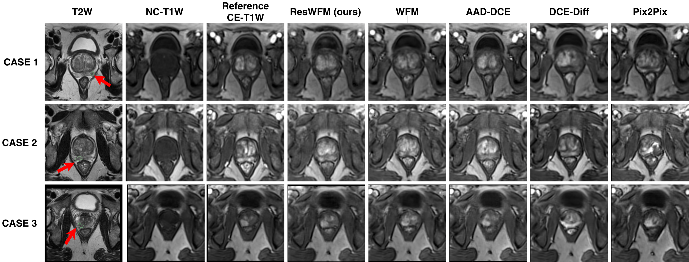

# ResWFM: Zone-Aware Residual Wavelet Flow Matching for Contrast-Enhanced Prostate MRI Synthesis

Building on Wavelet Flow Matching (WFM), we introduce **ResWFM**, a framework for synthesizing late-phase contrast-enhanced T1-weighted (CE-T1W) prostate MRI from multimodal non-contrast MRI. This task is challenging because enhancement depends on contrast-agent kinetics and tissue-specific vascular properties that cannot be directly observed in non-contrast images. The model must infer these signals from indirect anatomical and functional information, including subtle, spatially localized enhancement patterns. ResWFM addresses this challenge by using non-contrast T1-weighted (NC-T1W) MRI as an anatomical anchor and learning the enhancement residual in a 3D Haar wavelet domain. Zone-aware feature modulation and a frequency-graded, zone-weighted training objective further tailor the framework to prostate anatomy. On the held-out test set, ResWFM achieved a whole-volume PSNR of 21.42 dB and SSIM of 0.789, with a whole-gland SSIM of 0.761 and peripheral-zone SSIM of 0.729. Inference takes 0.12 seconds per subject using a two-step Euler solver.

## Architecture

<p align="center">
  
</p>

ResWFM transforms four conditioning modalities (T2W, NC-T1W, ADC, and DWI) and the whole-gland signed distance function (SDF) into the 3D Haar wavelet domain. These features are concatenated with the flow state x_t to form a 48-channel input to a 3D U-Net velocity network with approximately 81.5 million parameters. The flow starts from a zero source (x_0 = 0), rather than random noise or an averaged image prior as we did in WFM. Two Euler steps integrate the predicted velocity to obtain the wavelet-domain endpoint x̂_1. The inverse DWT reconstructs the predicted enhancement residual Δ̂, which is added to the NC-T1W anchor to produce the synthesized CE-T1W volume. Zone-FiLM conditions encoder features on one-hot background (BG), transition-zone (TZ), and peripheral-zone (PZ) labels at each of the four downsampling stages. This modulation is applied alongside the frequency-graded, zone-weighted training objective.

## Qualitative results

<p align="center">
  
</p>

Three representative lesion-containing test cases (rows). From left to right: T2W (green lesion contour and arrow), NC-T1W, reference CE-T1W, and synthesized CE-T1W images from ResWFM, WFM, AAD-DCE, DCE-Diff, and Pix2Pix. The panels illustrate gland-wide enhancement patterns and signal appearance near the marked lesions relative to the reference. 

### Inference efficiency

Inference time was measured on an NVIDIA L4 GPU and is reported as the mean per-subject time across the test set.

| Model | Inference configuration | Parameters (M) | Avg. time (s/subject) |
|---|---|---:|---:|
| Pix2Pix | 2D, single-pass | 61.40 | 0.72 |
| AAD-DCE | 2D, single-pass | 11.38 | 0.35 |
| DCE-Diff | 100-step DDPM | 73.93 | 85.2 |
| T1C-RFlow | 50-step RFlow | 44.26† | 1.39 |
| WFM | 2-step Euler | 81.52 | 0.11 |
| **ResWFM (proposed)** | **2-step Euler** | **81.54** | **0.12** |

† T1C-RFlow additionally uses a frozen, pretrained MAISI variational
autoencoder (20.94M parameters) for latent encoding/decoding, not included
in the trainable parameter count shown.

### Reconstruction and enhancement fidelity

Results on the held-out test set (57 subjects; lesion-level analysis in 34 subjects with annotated index lesions):

**Whole-volume fidelity:** WFM achieved the highest whole-volume PSNR and SSIM (22.67 dB and 0.812). ResWFM achieved 21.42 dB and 0.789, respectively.

**Zonal SSIM:** ResWFM achieved the highest SSIM among the evaluated methods in the whole gland (0.761), transition zone (0.751), and peripheral zone (0.729). These results highlight a trade-off between whole-volume and zonal image fidelity rather than uniform superiority of either WFM or ResWFM.

**Whole-gland enhancement MAE:**ResWFM achieved a lower MAE than WFM (0.0895 vs. 0.0985), with statistically significant improvements over the synthesis comparators after Holm correction (adjusted p ≤ 0.001).

## Installation

```bash
git clone <this-repository-url>
cd ResWFM-release
pip install -r requirements.txt
```

Requires Python 3.10+, PyTorch 2.0+. A GPU is strongly recommended for
training; inference (1–2 integration steps) is fast enough to run on CPU for
a single case.

## Inference / usage

No trained checkpoint or example data ships in this repository (see
[Data and pretrained weights](#data-and-pretrained-weights)), so you need
your own checkpoint and your own correctly-formatted inputs to run this.
The inference pipeline itself has been exercised end-to-end against a
trained checkpoint and a real test case external to this repository,
producing geometrically and numerically valid output consistent with
expected reconstruction quality — see
[`inference/README.md`](inference/README.md) for the full workflow. This
confirms the pipeline is correct; it does not establish accuracy across a
full cohort, and no checkpoint or test data is included here for you to
reproduce that result directly.

1. **Obtain or train a checkpoint** — see
   [Data and pretrained weights](#data-and-pretrained-weights).
2. **Prepare input volumes** as `T2.nii.gz`, `ADC.nii.gz`, `DWI.nii.gz`,
   `NC_T1.nii.gz`, `mask.nii.gz` — see
   [Data format](#data-format-expected-input-contract) below. `CE_T1.nii.gz`
   is optional at inference: it is never passed to the model as a
   conditioning input (only `T2`, `ADC`, `DWI`, and `NC_T1` are), but if
   present, a copy is saved alongside each prediction for comparison.
   Preprocessing to this exact format is not included in this repository
   (see [Data and pretrained weights](#data-and-pretrained-weights)).
3. **Run inference**, on a single subject or a folder of subjects — see
   [`inference/README.md`](inference/README.md) for both worked examples,
   or use the test-manifest workflow:
   ```bash
   bash run_reswfm.sh sample_test
   ```

For the full training/resume/sample/eval command set:

```bash
export RESWFM_DATA_DIR=/path/to/your/dataset
export RESWFM_SPLIT_DIR=/path/to/your/split/manifests

bash run_reswfm.sh sanitycheck   # 10 iterations, smoke test
bash run_reswfm.sh train         # full training run
bash run_reswfm.sh resume        # resume from the latest checkpoint
bash run_reswfm.sh sample_test   # inference on the test manifest
bash run_reswfm.sh eval_test     # PSNR/SSIM/MSE/MAE within the prostate mask
```

## Data format (expected input contract)

```
<subject_dir>/T2.nii.gz
<subject_dir>/ADC.nii.gz
<subject_dir>/DWI.nii.gz
<subject_dir>/NC_T1.nii.gz
<subject_dir>/CE_T1.nii.gz      # required for training; optional at inference (never fed to the model)
<subject_dir>/mask.nii.gz       # 0=background, 1=TZ, 2=PZ
```

NC_T1 and CE_T1 must be normalized with **NC_T1's own** foreground intensity
window applied to both (never a window derived from CE_T1, which is
unavailable at inference time) — this is required by the residual
formulation, not a preprocessing convenience.

## Data and pretrained weights

- **Data.** No imaging data is distributed here. The training cohort is a
  single-institution dataset and is not yet publicly released.
- **Preprocessing.** The resampling/cropping/normalization pipeline that
  turns raw DICOM/NIfTI into the model's expected input format is not
  included in this repository. [`inference/README.md`](inference/README.md)
  documents the *expected output* format of that pipeline so the model's
  input contract is fully specified even without the pipeline itself.
- **Split manifests.** Train/val/test subject-ID lists are withheld along
  with the data they index.
- **Trained checkpoints.** Not released yet. Once available, a checkpoint
  trained on the 160×160×32 configuration will be published separately
  (e.g., Zenodo or Hugging Face Hub) and linked from this README, along
  with the exact training command used.

Because of the above, **inference does not work immediately after cloning**
this repository — you need your own checkpoint (trained with
`run_reswfm.sh train` on your own correctly-formatted data) and your own
correctly-formatted input volumes.

## Repository structure

```
ResWFM-release/
├── docs/figures/              Architecture + qualitative-results figures
├── guided_diffusion/          Model, losses, Zone-FiLM, data loader
├── DWT_IDWT/                  3D Haar DWT/IDWT (CC BY-NC-SA 4.0, see below)
├── scripts/                   Train / sample (inference) / evaluate entry points
├── inference/                 Worked single-case inference example
├── run_reswfm.sh              Genericized train/sample/eval driver script
├── requirements.txt
└── LICENSE, THIRD_PARTY_NOTICES.md, DWT_IDWT/LICENSE
```

## License and third-party notices

This repository is **dual-licensed**:

- Everything except `DWT_IDWT/` is **MIT** (see `LICENSE`).
- `DWT_IDWT/` (the Haar DWT/IDWT implementation) is **CC BY-NC-SA 4.0**
  (Adobe Inc.), **non-commercial only** — see `DWT_IDWT/LICENSE`.

See `THIRD_PARTY_NOTICES.md` for the full explanation and attribution
chain.

## Citation

```bibtex
@article{anonymous2026reswfm,
    title   = {Zone-Aware Residual Wavelet Flow Matching for Contrast-Enhanced Prostate MRI Synthesis},
    author  = {Anonymous Authors},
    journal = {IEEE Transactions on Medical Imaging},
    year    = {2026},
    note    = {Under review}
}
```
